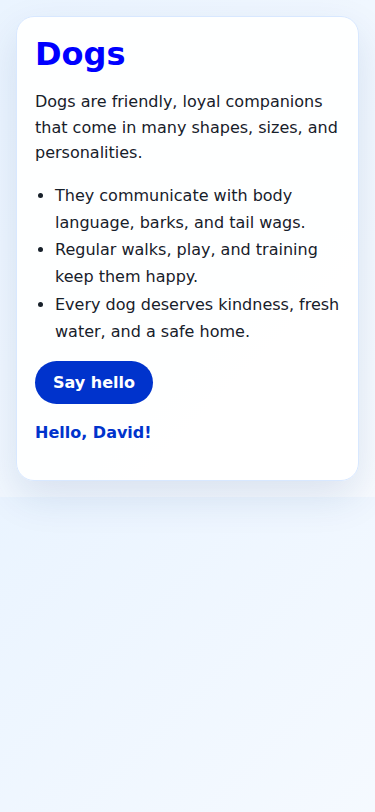
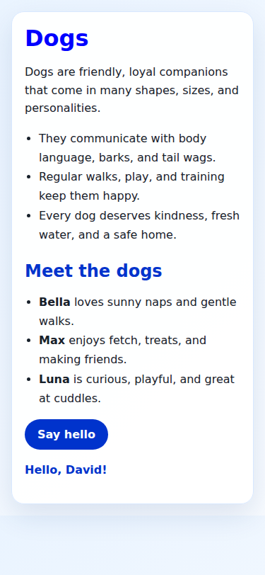

# BranchWrite: client installation

Setting up both computers yourself? Start with the
[desktop-and-laptop guide](TWO-COMPUTER-SETUP.md).
Use this shorter page when your server is already running.

BranchWrite helps you make and change files by talking to a model.
You use two computers:

- **Server:** runs Context COW and the model. Your operator sets it up.
- **Client:** runs BranchWrite. This is the computer where you keep your project.

You do not need a GPU or model download on the client.

## Before you start

This preview supports 64-bit Intel/AMD Linux. These steps use Ubuntu or Debian.
Ask your operator for the server address and API key. An API key is a password
for this service. Do not put it in a project file or screenshot.

Open Terminal. Install the small system tools:

```sh
sudo apt update
sudo apt install -y curl git ca-certificates bubblewrap util-linux
```

The computer may ask for your Linux password. Letters do not appear as you type.
That is normal. Press Enter when you finish.

## Install BranchWrite

Copy this whole line into Terminal, then press Enter:

```sh
curl -fsSL https://raw.githubusercontent.com/CC-David-CC/BranchWrite/lan-preview-2026-10-21/install.sh -o "$HOME/branchwrite-install.sh" && sh "$HOME/branchwrite-install.sh"
```

Wait for **BranchWrite is installed**. The first installation needs Internet
access. It downloads the client and its Python packages, not the model.

The installer downloads its own Python and packages. It does not replace the
computer's Python. You do not need to activate a virtual environment.
A virtual environment is a separate place for a program's Python packages.

## Choose a project folder

For a new project:

```sh
mkdir -p ~/my-first-website
cd ~/my-first-website
~/.local/bin/bw
```

For an existing project, open Terminal in that folder and run
`~/.local/bin/bw`. That full path works even if typing `bw` is not set up yet.

## Connect

At **Server address**, type the address your operator gave you, for example
`http://10.0.7.68:18099`. Use the server computer's LAN address.
`127.0.0.1` means this computer; it does not mean another computer on your LAN.

At **API key**, paste your key and press Enter. The key stays in memory for this
session. It is not saved by default.

## Ask for a change

Try:

> Make a pretty one-page website about dogs. Use one HTML file. Make it work on
> a phone. Add a button that shows a friendly greeting. Do not download anything.

Then ask:

> Make the dog names bold. Keep the greeting button working.

Work mode changes the project folder you opened. BranchWrite keeps saved file
versions so you can go back or explore another idea. Use `/explore` when you want
a separate copy. A successful command means its chosen checks passed; it does
not prove every part of a website is correct.

## While it works

- **Enter:** send a request, or add information to the active request.
- **Tab:** queue text for the next turn. Follow-up text is combined.
- **Esc:** ask it to stop at a safe boundary.
- **Ctrl+R:** search what you typed before.
- **/plan:** inspect and discuss without changing project files.
- **/work:** return to making changes.
- **/aside YOUR QUESTION:** ask a side question without changing the main context.
- **/exit:** save and leave. Run BW from the same folder to reopen this session.

The fresh-VM smoke exercised installation, connection, Work, exit, reopening and
a follow-up change after both server processes restarted. The other controls
have separate tests; this smoke did not rerun every control.
A stopped run and an uncertain server reply must be resumed with their saved
identity, rather than submitting the same operation as unrelated new work.

## What stays on each computer?

Your project and BW's saved workflow are on the client. The server receives
the project content needed by the task and keeps the model's context.
Only use a server you trust. Keep project secrets out of the selected folder.

## Updating

Installations use separate versioned runtime folders. Keep old runtime folders
while you have saved work that uses them. Never delete an old runtime just to
make an update appear successful.

## What the tested result looked like

The first request made this page. The independent browser check clicked its
button and saw the greeting:



We closed BW and restarted the server. We opened BW in the same project folder
and asked it to add Bella, Max and Luna with bold names. The button still worked:



The full request times were about 3 minutes 41 seconds, then 2 minutes 23 seconds
on the tested Q4 server. These include model thinking, tools and saved-state
work. They are not decode-speed measurements or promises for another machine.

The client was a fresh BW install in an existing Ubuntu VM. Its real shell/file
isolation check passed. The page checks used a separate sandboxed Chromium
browser with a temporary host permission profile, which was then removed.
That audit's browser-worker setup failure has since been corrected in the
[separately tested Linux browser worker](https://github.com/CC-David-CC/BranchWrite/tree/feat/browser-client-linux/validation/browser-client-20261020).
The standard client installer still does not enable model-driven browser tools.
Use `/preview` to review the HTML in your own browser. Full stress/security/
numerical certification remains separate.

For server setup, use [the Context COW server guide](https://github.com/CC-David-CC/Private_Context_COW/blob/main/docs/CONTEXT-COW-SERVER.md).

For a tested existing-code example, see [repair a contact directory](../examples/repair-contact-directory/README.md). It includes the exact requests and optional queued/alternative-version steps.
