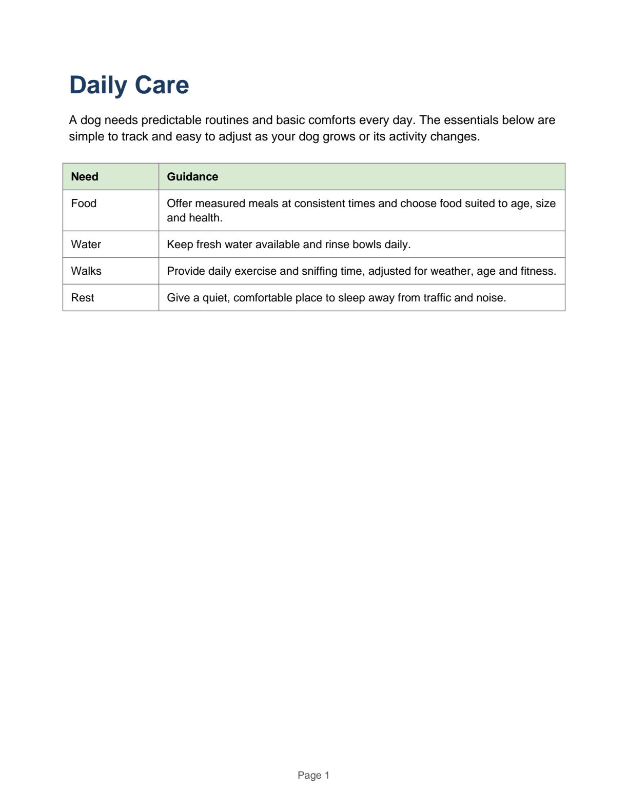
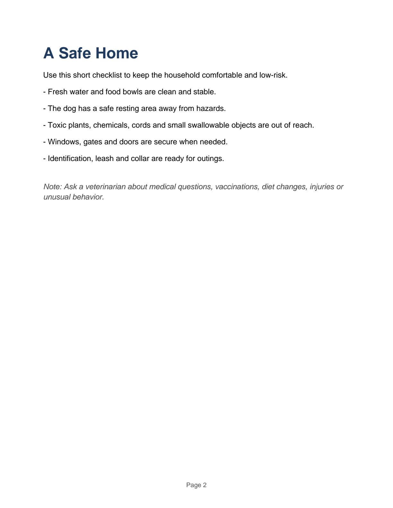

# Make and improve a PDF

Your operator installs BranchWrite and starts Context COW. The normal BranchWrite
installation already includes ReportLab, a PDF reader and a page renderer. You
need no PDF configuration file and should not install packages during a task.

Open a terminal in your project folder. Run branchwrite. Ask, for example:

    Make a two-page PDF about caring for a dog. Put daily care on page 1
    and home safety on page 2. Review both pages and fix anything clipped.

Keep talking to request changes. Saved versions and alternative explorations use
the existing BranchWrite controls. The actual files live on the client host shown
at startup. If you SSH into that host, its paths are remote paths.

For a repeatable one-shot job:

    branchwrite code . --project-files --task-file /path/to/examples/prompts/pdf.txt

That command uses an owned project copy. Its result names the workspace and exact
PDF/image exports. It leaves the original folder unchanged.

## How the agent does it

Write ordinary ReportLab Python in the project. The isolated build saves its
internal export as document.pdf. build_pdf(path,output) independently reopens that
export, renders page 1 and publishes it to the requested project-relative PDF
path. render_pdf(path,page) supplies another actual page image. Pages are counted
from 1. Review every current page, fix the source if needed, rebuild, render the
new pages and run meaningful current run_check commands before finish.

A parsed PDF is not proof of good layout. Page images must be judged and content
must be checked. Old images do not describe a changed document. A later failed
build cannot borrow earlier acceptance; its prior saved PDF remains available.

Initial limits: Linux isolated workers, PDF up to 4 MiB, up to 256 pages, selected
page previews up to 1600 pixels per side. A 20-page fixture is tested; this is not
a 256-page model-authoring qualification. Encrypted PDFs and unsupported oversized
page geometry reject explicitly. PDF forms and JavaScript are not executed.
Unknown publication effects retain their original operation identity; do not
resend a new operation as an automatic recovery strategy.

Current executed status and limitations are in validation/pdf-20261020/README.md
and examples/prompts/results.json. Real model evidence is separate from worker
fixture tests. This guide describes the implemented interface, not an unexecuted
claim that every example succeeds on every model.

## An actual model-created example

The exact pdf.txt request passed with Q4 through the installed CLI. These images
come from the saved model-authored report.pdf. Both were submitted to subsequent
native model requests; no operator wrote the candidate source. This run took
493.635seconds. It demonstrates authoring and page review; later-request revision
and restart still need their own executed results.

After an interactive Work turn saves report.pdf, /preview report.pdf opens that
exact selected version through the existing private loopback preview. On an SSH
client, follow the printed tunnel command. No extra PDF server is needed. Plain
text works with /preview START_HERE.txt. One-shot code jobs still return their
owned workspace and immutable exports; they are not silently published into the
original directory.
