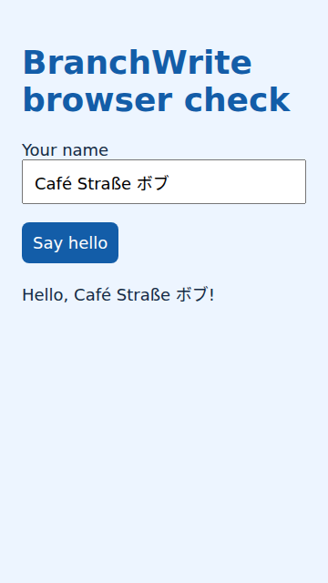
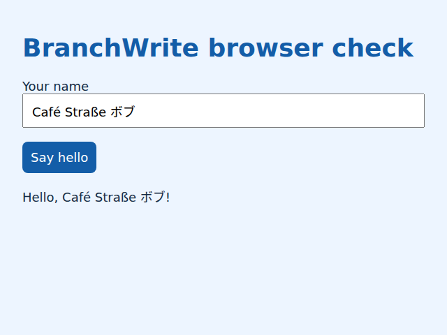

# Browser worker validation — 2026-10-20

Result: **86/86 selected methods passed**, zero failures, errors or skips, in
53.532 seconds in the final run after font installation. This mixes real Chromium/process/filesystem tests with unit and
fault-injection checks; it is not 86 inference tests. See `result.json` for every
executed ID and the explicit two-module exclusion.

The unchanged real namespace test first failed because the application-managed Python base
was not mounted. After that correction, 2/3 namespace/browser tests passed;
Chromium itself refused the VM policy. The authorized dedicated root-owned
launcher/profile then passed all three unchanged real tests. Global AppArmor
restriction stayed enabled and the distribution's Bubblewrap policy was not
edited. A separate real worker witness observed zero Linux capabilities,
non-root execution and no-new-privileges.

An added error-reporting regression failed before the diagnostic fix, then
passed. An initial broader 86-method attempt had one failure and eight errors:
eight results came from a fixture hard-coding another user's browser path; the
CLI capture test lacked an unchanged imported helper in the diagnostic copy.
The fixture now uses the host-selected browser environment variable, matching
the other modules. Acceptance assertions were not weakened. The helper was
copied unchanged. The complete selected suite then passed.

Separate operator-authored desktop/phone checks performed actual fill and click,
retained exact Unicode DOM results and PNGs, and confirmed worker retirement.
Visual review caught missing Japanese glyph fonts despite correct DOM text;
installing the distribution CJK font package fixed the rendered glyphs. The
final 86-method rerun also passed.
One extra smoke harness attempt had a Python string-construction syntax error;
another selected system Python instead of the application environment and lacked
Pillow. Neither attempt is model or product acceptance evidence.

No source/runtime in the installed client was overwritten. No model/GPU work
ran in this browser selection. Automatic browser use in a normal directory
session and delivering its screenshots through the currently configured COW
image producer remain separate integration work. No G gate status changes.

See [setup and removal](../../docs/BROWSER-CLIENT-SETUP.md). The result file lists
every executed test ID, runtime fingerprints and measured namespace witnesses.

## Inspected output

Phone (360 × 640), after actual fill and click:

Desktop (640 × 480):

